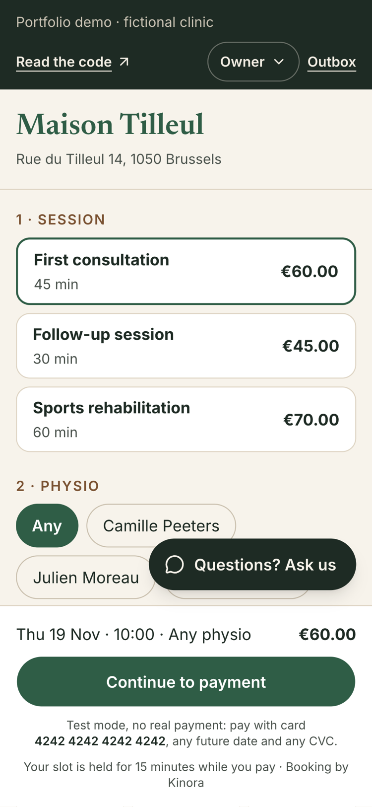

# Kinora


Kinora is an online booking app for small physiotherapy clinics: patients book and pay a session, cancel with an automatic refund and get a reminder the day before. The demo clinic is Maison Tilleul, a fictional practice in Brussels.

**Live app: https://kinora-booking.vercel.app**



## Features

- Clinics with three roles: owner, practitioner and patient, enforced by row level security
- Services, weekly hours, days off and free-slot calculation, with no double booking
- Booking paid with Stripe Checkout (test mode), confirmed by an idempotent webhook
- Cancellation up to 24 hours before, with an automatic full refund
- Confirmation, reminder and refund emails, each sent exactly once
- Dashboards for the owner and the practitioner
- An assistant that answers patient questions from the clinic's own data
- A no-sign-up demo: your own seeded clinic and a "View as" bar to switch roles
- English and French: a switch in the top bar, or `?lang=fr` on any address; emails go out in the language the patient booked in

Progress, task by task: [ROADMAP.md](ROADMAP.md).

## Stack

Next.js 16 (App Router, Server Actions) · React 19 · TypeScript · Tailwind CSS 4 and shadcn/ui · Supabase (Postgres, Auth, row level security) · Drizzle ORM · Zod · Vercel

## How it is built

- **Mobile first.** Every screen is designed at 375 px, then widened. Pages render on the server, so phones download little JavaScript.
- **Every input is validated on the server** with Zod, and every action checks the signed-in user.
- **One folder per feature** in `src/features/`, so a new feature does not touch the others.
- **Two languages, the same addresses.** The proxy serves each page from `src/app/[lang]/` in the language of the `lang` cookie, so pages are still prerendered once per language. The strings live in typed dictionaries (`src/i18n/en` is the source, `src/i18n/fr` must match it key for key). A patient's language is kept on their account, so the webhook and the reminder job write to them in it.
- **Small, readable commits**, each tied to a roadmap task. CI runs the typecheck, lint, tests, build, the Playwright journeys, the database tests on a local Supabase and a secret scan on every push.

## Technical report

A booking app that takes money has five places where "it works on my machine" is not enough. For each one: the risk, what Kinora does, why, and the test that proves it. The `*.db.test.ts` files run against a real Postgres with `pnpm test:db`, locally and in CI on every push; each test is rolled back, except the concurrency tests, which need committed rows and delete them afterwards.

### 1. Clinic isolation

**Risk.** Several clinics share one database. A missing `where clinic_id = …` in one query, or a direct call to the Supabase API, would show one clinic's patients to another.

**What Kinora does.** Access is enforced by Postgres row level security, not by the app's queries. Every user query runs through `withRls()` (`src/lib/db.ts`), which opens a transaction as the `authenticated` role with the user's id, so Postgres applies the policies written next to each table in `table.ts`. The policies call two helpers, `private.is_member()` and `private.has_role()` (`drizzle/0001`), in a schema the Supabase API does not expose. An event trigger (`drizzle/0000`) turns RLS on for every new table, so a table without policies denies everything instead of exposing everything. Nobody writes bookings directly: there is no write policy on `bookings`, and holding, cancelling and confirming go through database functions that check the caller and the rules themselves (`drizzle/0014`, `0018`, `0019`).

**Why.** One forgotten filter in the app is a data leak; one forgotten policy is a denied query. RLS also covers the Supabase Data API, which a user can call with their own token, bypassing the app.

**Proof.** `src/db/cross-clinic.db.test.ts` checks that RLS is on for every table, and that an owner can neither read, change, join nor email for another clinic, even with its id. `roles.db.test.ts` checks that a patient sees no other patient and a practitioner changes no role. `agenda.db.test.ts` checks that a physio never gets a colleague's sessions, even when asking for them, and `my-bookings.db.test.ts` that a patient gets only their own.

### 2. No double booking

**Risk.** Two patients look at the same free 10:00 slot and pay at the same second. Checking "is the slot free?" and then inserting leaves a gap where both checks pass.

**What Kinora does.** The app computes free slots for display, but the database has the last word: an exclusion constraint (`drizzle/0011`) refuses any two bookings of the same physio whose time ranges overlap, as long as they are pending payment or confirmed. Ranges are `[start, end)`, so back-to-back sessions are allowed. A slot is held for 15 minutes while the patient pays; an expired hold frees it.

**Why.** A constraint holds whatever the timing, the number of servers or the code path. Locks or a "check then insert" in the app would each need to be right in every place that books.

**Proof.** `src/db/double-booking.db.test.ts` opens two connections that insert the same slot and wait before committing, so the two transactions overlap: exactly one succeeds, the other is refused. It usually gets SQLSTATE `23P01`, but the CI once caught Postgres ending it with a deadlock (`40P01`) instead, which the booking page would have shown as an error. The slot hold now runs again once after a deadlock, so the retry sees the other booking and the patient gets "slot taken" (`src/lib/pg-errors.test.ts`). It also checks a one-minute overlap is refused and an expired hold cannot come back over a newer booking.

### 3. Stripe webhook replay

**Risk.** Stripe delivers a webhook at least once: retries, and sometimes the same event twice at the same moment. A naive handler confirms the booking twice and sends two confirmation emails. And a patient who closes the tab before coming back from Stripe must still see their booking.

**What Kinora does.** The webhook (`src/features/booking/webhook.ts`) first checks Stripe's signature on the raw body. Then, in one transaction (`payment.ts`), it inserts the event id into `stripe_events`, whose primary key makes a second delivery a no-op, locks the booking row and confirms it only if it is still pending. The confirmation email is queued in the same transaction, so it exists if and only if the booking was confirmed. If the transaction fails, the event is not recorded and Stripe's retry gets a fresh try. A payment that arrives after its hold expired is confirmed if the slot is still free, and refunded in full if someone else took it. The return page asks Stripe directly whether the session is paid and settles it the same way, so a late webhook never leaves a paid patient looking at "pending".

**Why.** Idempotency on the event id is what Stripe recommends, and doing it in the same transaction as the confirmation means there is no moment where the event is marked handled but the booking is not.

**Proof.** `src/db/stripe-webhook.db.test.ts` replays the same event and confirms once; sends the same event on two connections at the same moment and confirms once; checks the event is recorded only when the booking is settled; and covers the late payment, confirmed or refunded. `confirmation-email.db.test.ts` checks the second call queues no second email.

### 4. One reminder per booking

**Risk.** A cron that runs twice (a retry, a manual run, two deployments) sends every patient two reminders.

**What Kinora does.** Every email is first a row in the `emails` table (`drizzle/0005`) with a unique `dedupe_key`, here `booking_reminder:<booking id>`. The daily job (`src/features/booking/reminders.ts`) selects tomorrow's confirmed sessions, in Brussels time, and inserts their reminders with `on conflict do nothing`: a booking that already has its reminder gets nothing new. Sending (`src/features/email/outbox.ts`) moves a row from "pending" to "sending" in one update, so only one caller sends it, and passes the row id to Resend as an idempotency key. A cancelled or refunded booking is not "confirmed", so it never gets a reminder.

A Vercel cron (`vercel.json`) calls `/api/cron/reminders` every day at 16:00 UTC, that is 17:00 in Brussels in winter and 18:00 in summer. The route checks `Authorization: Bearer $CRON_SECRET` with a constant-time comparison. Set `CRON_SECRET` in Vercel, then try it by hand:

```bash
curl -H "Authorization: Bearer $CRON_SECRET" https://kinora-booking.vercel.app/api/cron/reminders
```

**Why.** The free Vercel cron runs once a day, which is enough for a day-before reminder. The guarantee does not depend on the scheduler: it lives in a unique key, so any number of runs, at any time, gives one email.

**Proof.** `src/db/reminders.db.test.ts` runs the job twice in a row and twice at the same moment on two connections, and gets one reminder; it also checks cancelled, refunded and unpaid bookings get none, and that the demo's per-clinic run leaves other clinics alone. `reminders-cron.test.ts` checks the bearer token.

### 5. Assistant limits

**Risk.** The assistant on the public page calls a language model for anyone, without an account. Without limits, a script can spend the whole free Groq quota; without checks, the model can invent a free slot or give medical advice.

**What Kinora does.** Each question (`src/features/assistant/actions.ts`) is parsed with Zod, rate limited per IP, then counted against 15 questions per visitor per Brussels day, in the database, before Groq is called. The count is one upsert that stops at the limit (`quota.ts`), so two questions sent together cannot both take the last place. The visitor is a hash of the IP and the day, never the IP itself, and the daily clean-up job deletes past days. The model only knows the clinic's public facts, and gets free slots through one tool that calls the app's own slot calculation. Its reply is checked: if it names a time the app did not compute, it is replaced by a sentence built from the app's slot. Groq gets a 10-second timeout and a fallback model; when both fail, or the quota is reached, the visitor sees a short message and can still book on the page. The opening note asks patients not to share health details.

**Why.** A counter in memory resets on every serverless instance; the database is shared by all of them. And a booking app must never promise a slot that does not exist, so the model writes the sentence but the app owns the facts.

**Proof.** `src/db/assistant-quota.db.test.ts` checks 15 questions then a refusal, separate counts per visitor and per day, no IP stored, and one winner when two questions race for the last place. `src/features/assistant/conversation.test.ts` checks the slot shown is the app's, a reply with an invented time is replaced, invalid tool arguments are refused, and the model gets at most three turns.

## Run it locally

```bash
corepack enable
pnpm install
cp .env.example .env.local   # fill in the values
pnpm db:migrate
pnpm dev
```

## Scripts

| Command | What it does |
|---|---|
| `pnpm dev` | Local server on http://localhost:3000 |
| `pnpm check` | Typecheck, lint, unit tests |
| `pnpm test:db` | Row level security tests against the database in `DATABASE_URL`, rolled back after each test |
| `pnpm e2e` | Playwright journeys on a phone viewport |
| `pnpm db:generate` | Create a migration from the tables in `src/features/*/table.ts` |
| `pnpm db:migrate` | Apply migrations |

## Try the demo

"Try the demo", in the bar above every page, signs the visitor in with an anonymous Supabase account and creates their own copy of Maison Tilleul: three physios, three services, six patients and two weeks of paid and refunded sessions. The visitor owns that clinic, so row level security treats them like any owner. Sessions from today on are paid with real Stripe test payments, so cancelling one makes a real test refund.

"View as Owner / Practitioner / Patient" then replaces the button. It changes the visitor's real role, not just the screens: the visitor swaps places with Camille Peeters (a physio) or Nora Benali (a patient), memberships and bookings included, so row level security shows them exactly what that person sees. They get the owner's place back before each switch, so at most one seeded account is out of place.

No real email leaves a demo clinic. A database trigger (`drizzle/0020`) stores every email of a clinic an anonymous visitor started, and every email to a reserved `.example` address, as "held", and only pending emails are ever sent. The "Outbox" link in the bar shows them to the visitor in every role, with a "Send tomorrow's reminders now" button that runs the reminder job for their clinic: clicked twice, it still queues one reminder per booking. Stripe runs in test mode only, so the booking bar and Stripe Checkout both show the test card 4242 4242 4242 4242.

It needs anonymous sign-ins: Supabase > Authentication > Sign In / Providers > "Allow anonymous sign-ins". A second Vercel cron, `/api/cron/demo-cleanup` at 03:00 UTC, deletes anonymous accounts older than 24 hours with the accounts seeded for them; their clinic and bookings go with them. Each new demo also runs that clean-up. Real accounts are never deleted: the job only matches anonymous accounts and the ones the seed marks in `app_metadata`, which users cannot change.

## License

This code is shared publicly as a portfolio sample. No license is granted: you may read it, but you may not copy, modify, distribute or reuse it, in whole or in part, without written permission.
